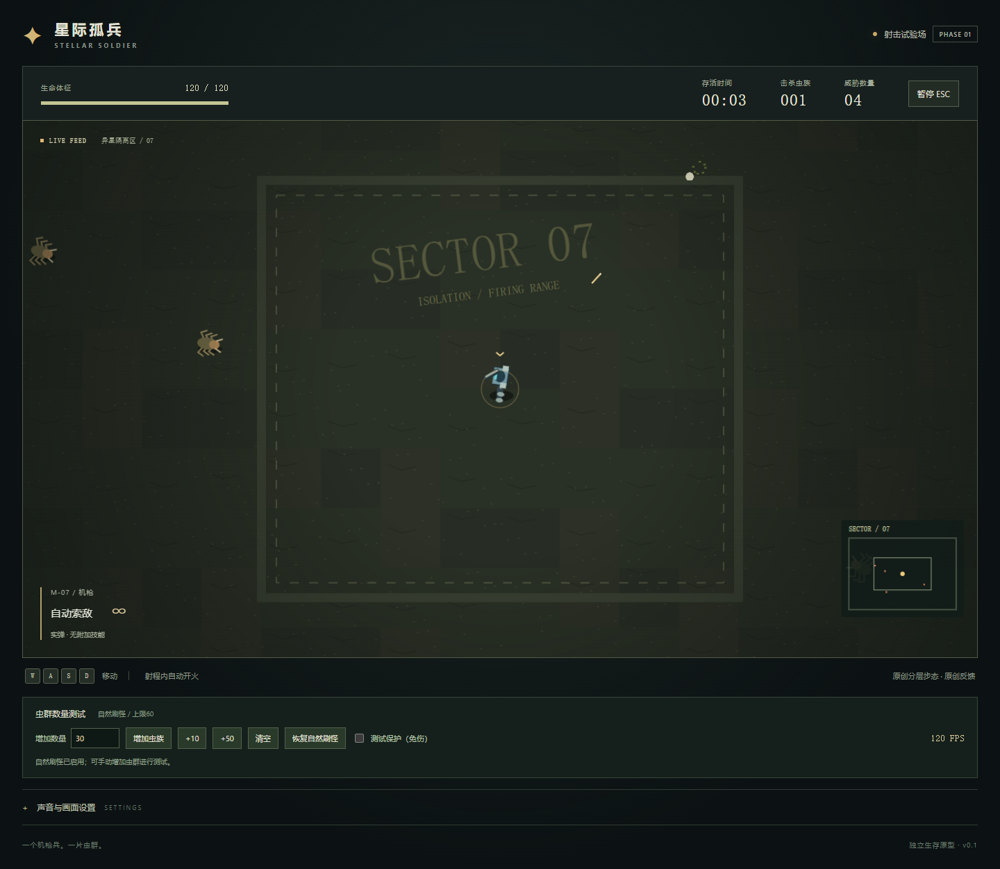

# 星际孤兵 · Stellar Soldier

俯视角科幻单人生存游戏设计：操控一名人类机枪兵在大地图持续战斗，拾取随机技能与科技装备，消耗水晶强化，面对逐波增强的敌人，直到死亡。

最新方向：**机枪兵本质不变，连续射击虫族；后续技能附加于子弹和命中效果。** 第1阶段射击样片已实现，后续阶段见[开发计划清单](docs/22-development-checklist.md)。

**当前版本：v0.1射击试验场。** 包含小战场移动、机枪自动射击、跳虫追击、受伤死亡、暂停与重开；完整波次、成长、装备和8项子弹技能尚未实现。以下核心规则是完整游戏目标。

最新更新：机枪兵使用16方向、9帧交替腿部步态，上身独立瞄准，支持边走边打、脚步尘迹/声音、受击和短死亡表现；无本地素材也有原创分层腿部动画。

## 启动与验证

需要Node.js 22.12+（本轮使用22.20.0）。

```powershell
npm ci
npm run dev
```

试玩地址：[http://127.0.0.1:5180/](http://127.0.0.1:5180/)。WASD/方向键移动，射程内自动开火，Esc或按钮暂停，死亡后重新出击。设置可切换程序化单位、总静音与音效音量；音乐未接入。失焦自动暂停，返回后需手动继续。

画面下方“虫群数量测试”可输入1–300只、点击增加，另有+10/+50、清空和恢复自然刷怪。手动增加后停止自然生成，总量最多300；可选测试保护免伤，状态始终显示。恢复自然刷怪会清空测试虫、关闭保护；重开恢复默认。右侧FPS是当前场景约1秒滚动采样，不代表跨设备性能保证。

```powershell
npm test
npm run typecheck
npm run build
npm run preview -- --port 5181
```

浏览器验收需开发服务运行及Playwright Chromium；首次没有浏览器可运行`npx playwright install chromium`。可用`PLAYWRIGHT_EXECUTABLE_PATH`指定已有兼容Chromium。运行`npm run verify:browser`；同时运行预览服务并设置`VERIFY_PREVIEW_URL=http://127.0.0.1:5181`可附加生产版验收。

18项规则测试、类型检查和构建通过；基础浏览器18项检查和动作/数量专项13项检查通过。专项验证实际脚部像素变化、8向移动、移动射击、暂停、重开、坏步行图回退、数量封顶/非法输入与密集场景。运行`npm run verify:motion`复现；详情见[动作与数量验收](artifacts/marine-motion-verification.md)。音效实听、最终动作美术、完整5技能长期压力与平衡仍待后续验证。



## 核心规则

- 大地图移动、自动射击，连续无限波次，死亡结束本局。
- 经验升级增强基础属性；水晶强化随机掉落的具体装备。
- 杀敌随机掉落一个技能，可学习、遗忘、替换；总计最多5个。
- 最新技能池为8种自动附加：穿透、跳弹、爆裂、电弧、燃烧、冷凝、重击、战术装填；同时最多5项。旧主动施法示例已取代。
- 随机科技装备包含品质、词条和特殊效果；主武器为机枪组件，实弹、热能、电磁倾向可混搭，保持机枪射击。
- 少素材起步：一套机枪兵主体，通过弹道、命中和护盾特效表现装备差异，之后再补武器、肩甲和背包模块。

## 文档

- [开发计划与可勾选清单](docs/22-development-checklist.md)
- [机枪兵动作完整性与数量测试](docs/23-marine-motion-and-crowd-testing.md)
- [需求分类与虫族细则](docs/19-requirements-index.md)
- [详细子弹技能、效果制作与参考](docs/21-bullet-skills.md)
- [图形、音频支援与塔防资源复用](docs/20-graphics-audio-resources.md)
- [需求登记与流程](docs/00-requirement-process.md)
- [生存玩法与五技能规则](docs/16-marine-survival-concept.md)
- [科技装备、角色成长与外观](docs/17-survival-equipment-and-appearance.md)
- [独立项目迁移](docs/18-survival-project-migration.md)
- [实施与验证状态](docs/03-implementation-report.md)
- [协作规则](AGENTS.md)

文件编号保留原始来源。最新登记需求优先：动作和数量测试以需求25/26为准；技能/机枪身份以需求23为准，资源复用以需求22为准；其余装备强化沿用需求19，项目归属以需求20为准。文档中的数值均为建议，未经试玩平衡。

## 资源准备

已生成23张原创图形（含图集/图标）和8段PCM短音效，见[资源清单](public/assets/combat/manifest.json)、[归属说明](public/assets/combat/CREDITS.md)与[静态总览](artifacts/combat-resources-contact-sheet.png)。基础枪口/命中已接入；16方向枪口与弹体共用挂点。附加技能动态电弧及最终音频混音仍待实现。

复现原创资源需要Python 3与Pillow；准备本地包需要相邻星际塔防已有资源目录：

```powershell
python scripts/generate-combat-resources.py
python scripts/prepare-local-resources.py
python scripts/prepare-marine-motion.py
```

基础本地包选择机枪兵、跳虫、刺蛇、雷兽、爆炸和9项声音，共18个资源文件；动作准备另加1张未修改的Marine原图和1份动作元数据，均被Git忽略。样片已接入机枪兵步态/上身攻击姿态、跳虫及基础声音；其余留待后续。缺完整步行图时使用有腿部运动的原创机枪兵，不回退滑行静帧。坏单项不阻断其他素材；不提交或公开分发原版素材。

## 工程与下一步

TypeScript＋Canvas 2D＋Vite，独立编写，未复制塔防业务代码。`src/game/simulation.ts`负责规则，渲染/资源/音频分离，`tests/`覆盖碰撞与生存状态。小地图是测试战场的跟随视图，装饰不作障碍。当前自然刷怪1.5只/秒、上限60，不包含波次系统。

下一阶段先验证穿透、爆裂、电弧三种子弹技能，再补完整5技能槽和成长系统。开发环境加`?verify=1`才暴露验收接口，公开构建移除该接口。

本项目由星际塔防项目中的生存玩法构思独立迁出。原版图像/声音仅在被忽略的本地包内；本地版截图也不提交。生产构建只复制原创combat资源，随后检查路径和文件哈希，防止原版包进入公开构建。`dist/`不入库；本轮未部署公开网站。
